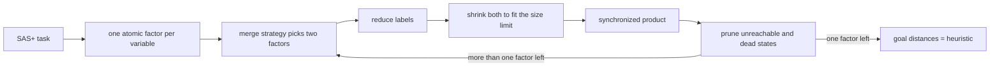

# merge-and-shrink

[](https://crates.io/crates/merge-and-shrink)
[](https://docs.rs/merge-and-shrink)
[](https://github.com/sunsided/merge-and-shrink/actions/workflows/ci.yml)
[](https://codecov.io/gh/sunsided/merge-and-shrink)
[](https://crates.io/crates/merge-and-shrink)
[](https://github.com/sunsided/merge-and-shrink#license)
[](https://github.com/rust-secure-code/safety-dance/)

Merge-and-shrink abstraction heuristics for factored transition systems, in `no_std` Rust (with `alloc`) and without unsafe code: atomic factors, synchronized products, linear, DFP and SCC-DFP merge strategies, exact label reduction, pruning of unreachable and dead states, and exact, greedy and size-bounded goal-respecting bisimulation.

Optimal planners such as A* need a heuristic that never overestimates the cost to the goal. Abstraction heuristics get one by mapping the huge concrete state space onto a much smaller abstract one, computing exact goal distances there, and using those distances as lower bounds. Merge-and-shrink builds such abstractions over *all* variables of a task at once, so it can capture interactions between variables that pattern databases, which project onto a few variables, cannot see.

The crate turns a SAS+ task (for example Fast Downward translator output, read through `sas-plus`) into a heuristic you can query per state: `value` returns the estimated cost, or `None` when the state is a proven dead end or was pruned as unreachable from the initial state. Because the heuristic also implements `sas_plus::Abstraction`, it plugs into [`cost-partition`](https://github.com/sunsided/cost-partition), which adds up several abstraction heuristics admissibly.

## Who this is for

- People building optimal planners or search algorithms in Rust who need a strong admissible heuristic; the heuristic search itself, A* and friends, lives in [`heuristic-search`](https://github.com/sunsided/heuristic-search).
- Researchers and students experimenting with abstraction heuristics, merge or shrink strategies, or cost partitioning, who want a small, readable, tested implementation to change and measure.
- Anyone who needs a reference h* on small tasks: with exact bisimulation and `prune: false`, the result is perfect on every state, so it can check other heuristics.
- To add several abstractions up admissibly, combine them with [`cost-partition`](https://github.com/sunsided/cost-partition); for delete-relaxation, landmark or red-black heuristics, use [`planning-heuristics`](https://github.com/sunsided/planning-heuristics) instead, and for exhaustive search over decision diagrams, [`symbolic-search`](https://github.com/sunsided/symbolic-search).

Without a size limit, exact bisimulation can still grow exponentially on large tasks. Set `max_states` (Fast Downward uses 50000) to bound every product; the heuristic stays admissible but is no longer perfect. The implementation favors readability over speed, so for large benchmarks Fast Downward remains much faster.

## Installation

```toml
[dependencies]
merge-and-shrink = "0.3"
```

## How it works



1. **Atomic factors.** Each variable becomes a small transition system over its values. Its labels are the task's operators.
2. **Pick.** A merge strategy picks the next two factors. `LinearMerge` merges the variables in a fixed order. `Dfp` picks the pair whose shared operators lead closest to the goal. `SccDfp` first merges the variables of each strongly connected component of the causal graph, then continues with `Dfp`.
3. **Reduce labels.** Operators of equal cost that only one factor can tell apart are combined into one label in every factor. This is exact and lets bisimulation group more states. The final abstraction is labeled with operator ids again.
4. **Shrink.** Both factors are shrunk so that their product fits `max_states`. A shrink strategy groups states that behave alike. `Bisimulation` starts from groups of states with the same goal distance and goal status, and splits them until all states in a group can reach the same groups by the same labels, which keeps every goal distance exact while often shrinking the factor a lot. At the size limit it stops splitting, closest to the goal first. `GreedyBisimulation` only looks at transitions on optimal paths, so it shrinks more but is no longer perfect after further merges. `NoShrink` keeps every state and ignores the limit.
5. **Merge and prune.** The two factors are replaced by their synchronized product: an operator moves both components at once, so the product tracks both variables together. States that are unreachable from the initial state, or that cannot reach a goal, are dropped.
6. **Evaluate.** After the last merge, the goal distances of the single remaining factor are the heuristic. A merge tree of lookup tables maps each concrete state to its abstract state, one table per merge, so evaluating a state is cheap.

On plain SAS+ tasks, exact bisimulation without a size limit makes the heuristic perfect: it equals the optimal cost on every state without pruning, and on every reachable state with pruning (`MergeAndShrink::new` prunes by default; pruned states evaluate to `None`). Conditional effects and derived variables (axioms) are over-approximated by the atomic factors, so there the heuristic stays admissible but can be lower.

## Usage

Build the heuristic for a task from Fast Downward's translator and evaluate it:

```rust
use merge_and_shrink::{Bisimulation, LinearMerge, MergeAndShrink, SccDfp};
use sas_plus::fdr::SasFile;

# let output_sas = concat!(env!("CARGO_MANIFEST_DIR"), "/tests/fixtures/gripper-costs/output.sas");
// `output_sas` is the path of a translator output file.
let task = SasFile::parse(&std::fs::read_to_string(output_sas)?)?.to_task();

let merge = LinearMerge::in_variable_order(task.num_variables());
let h = MergeAndShrink::new(merge, Bisimulation).build(&task);

// Exact bisimulation keeps goal distances: 7 is the optimal plan cost.
assert_eq!(h.value(&task.initial), Some(7));

// The configuration `task test:fd` compares with Fast Downward: SCC-DFP
// merging, label reduction, bisimulation, here at most 50000 states per product.
let h = MergeAndShrink {
    max_states: 50_000,
    ..MergeAndShrink::new(SccDfp::new(&task), Bisimulation)
}
.build(&task);
assert_eq!(h.value(&task.initial), Some(7));
# Ok::<(), Box<dyn std::error::Error>>(())
```

`None` from `value` means a dead end: no plan exists from that state. With pruning (the default), states unreachable from the task's initial state also evaluate to `None`, even goal states, so build with `prune: false` to evaluate states from another start.

## Tested

Without shrinking, and with exact bisimulation, h equals h* on **every** state of random tasks, for every merge strategy (any linear order, DFP, SCC-DFP), with and without label reduction. With pruning, h equals h* on the initial state. Greedy and size-bounded bisimulation, and tasks with conditional effects and derived variables (axioms), which atomic factors over-approximate, give admissible heuristics without false dead ends, and size-bounded products stay within the limit. The abstraction covers every concrete transition under its operator id. These hold as proptest properties and a fuzz target on random tasks, and on translator output.

`task test:fd` compares heuristic values with [Fast Downward](https://www.fast-downward.org/)'s merge-and-shrink (Docker image `aibasel/downward`) on states of the translated fixtures, in the same configuration. With exact bisimulation, both equal h* on every state; with a limit of 20 states, they agree on 49 of 53 states with exact and on all 53 with greedy bisimulation; the cause of the other 4 differences is not yet traced.

## Features

`no_std` (needs `alloc`). The crate has no Cargo features. It depends on `sas-plus` 0.2 without its default features.

## MSRV

Rust 1.85. Raising it is a minor-version change.

## Roadmap

Faster bisimulation (incremental signatures), caching merge scores, MIASM merging, and more Fast Downward comparisons on larger benchmarks.

## References

Helmert, Haslum, Hoffmann & Nissim (JACM 2014); Nissim, Hoffmann & Helmert (IJCAI 2011, greedy bisimulation); Sievers, Wehrle & Helmert (AAAI 2014, label reduction; IJCAI 2016, SCC-DFP); Dräger, Finkbeiner & Podelski (SPIN 2006, DFP); Sievers & Helmert (JAIR 2021).

## License

Licensed under either of

- Apache License, Version 2.0 ([LICENSES/Apache-2.0.txt](https://github.com/sunsided/merge-and-shrink/blob/main/LICENSES/Apache-2.0.txt))
- MIT license ([LICENSES/MIT.txt](https://github.com/sunsided/merge-and-shrink/blob/main/LICENSES/MIT.txt))

at your option. Test fixtures derived from VHPOP are GPL-2.0-or-later and are not part of the published crate; see [`REUSE.toml`](https://github.com/sunsided/merge-and-shrink/blob/main/REUSE.toml).

## Contributing

See [CONTRIBUTING.md](https://github.com/sunsided/merge-and-shrink/blob/main/CONTRIBUTING.md).

Unless you explicitly state otherwise, any contribution intentionally submitted for inclusion in this work by you, as defined in the Apache-2.0 license, shall be dual licensed as above, without any additional terms or conditions.
