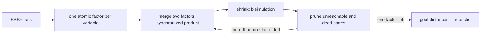

# merge-and-shrink

[](https://crates.io/crates/merge-and-shrink)
[](https://docs.rs/merge-and-shrink)
[](https://github.com/sunsided/merge-and-shrink/actions/workflows/ci.yml)
[](https://codecov.io/gh/sunsided/merge-and-shrink)
[](https://crates.io/crates/merge-and-shrink)
[](https://github.com/sunsided/merge-and-shrink#license)
[](https://github.com/rust-secure-code/safety-dance/)

Merge-and-shrink abstraction heuristics for factored transition systems: atomic factors, synchronized products, linear merge strategies, pruning of unreachable and dead states, and exact goal-respecting bisimulation. The resulting heuristic implements `sas_plus::Abstraction`, so it can feed [`cost-partition`](https://github.com/sunsided/cost-partition).

## What it is for

Optimal planners such as A* need a heuristic that never overestimates the cost to the goal. Abstraction heuristics get one by mapping the huge concrete state space onto a much smaller abstract one, computing exact goal distances there, and using those distances as lower bounds. Merge-and-shrink builds such abstractions over *all* variables of a task at once, so it can capture interactions between variables that pattern databases, which project onto a few variables, cannot see.

The crate turns a SAS+ task (for example Fast Downward translator output, read through `sas-plus`) into a heuristic you can query per state: `value` returns the estimated cost, or `None` when the state is a proven dead end or was pruned as unreachable from the initial state. Because the heuristic also implements `sas_plus::Abstraction`, it plugs into [`cost-partition`](https://github.com/sunsided/cost-partition), which adds up several abstraction heuristics admissibly.

## How it works



1. **Atomic factors.** Each variable becomes a small transition system over its values. Its labels are the task's operators.
2. **Merge.** A merge strategy picks two factors and replaces them by their synchronized product: an operator moves both components at once, so the product tracks both variables together. `LinearMerge` merges the variables in a fixed order.
3. **Shrink.** A shrink strategy groups product states that behave alike. `Bisimulation` starts from groups of states with the same goal distance and goal status, and splits them until all states in a group can reach the same groups by the same labels, which keeps every goal distance exact while often shrinking the product a lot. `NoShrink` keeps the full product.
4. **Prune.** States that are unreachable from the initial state, or that cannot reach a goal, are dropped.
5. **Evaluate.** After the last merge, the goal distances of the single remaining factor are the heuristic. A merge tree of lookup tables maps each concrete state to its abstract state, one table per merge, so evaluating a state is cheap.

On plain SAS+ tasks, exact bisimulation makes the heuristic perfect: it equals the optimal cost on every state without pruning, and on every reachable state with pruning (`MergeAndShrink::new` prunes by default; pruned states evaluate to `None`). Conditional effects and derived variables (axioms) are over-approximated by the atomic factors, so there the heuristic stays admissible but can be lower.

## Who it is for

- People building optimal planners or search algorithms in Rust who need a strong admissible heuristic.
- Researchers and students experimenting with abstraction heuristics, merge or shrink strategies, or cost partitioning, who want a small, readable, tested implementation.
- Anyone who needs a reference h* on small tasks: with exact bisimulation and `prune: false`, the result is perfect on every state, so it can check other heuristics.

Exact bisimulation does not bound the abstraction size, and only linear merging exists so far, so the final factor can grow exponentially on large tasks. For those, use Fast Downward until size-bounded shrinking and smarter merge strategies land (see the roadmap).

## Usage

Build the heuristic for a task from Fast Downward's translator and evaluate it:

```rust
use merge_and_shrink::{Bisimulation, LinearMerge, MergeAndShrink};
use sas_plus::fdr::SasFile;

# let output_sas = concat!(env!("CARGO_MANIFEST_DIR"), "/tests/fixtures/gripper-costs/output.sas");
// `output_sas` is the path of a translator output file.
let task = SasFile::parse(&std::fs::read_to_string(output_sas)?)?.to_task();

let merge = LinearMerge::in_variable_order(task.num_variables());
let h = MergeAndShrink::new(merge, Bisimulation).build(&task);

// Exact bisimulation keeps goal distances: 7 is the optimal plan cost.
assert_eq!(h.value(&task.initial), Some(7));
# Ok::<(), Box<dyn std::error::Error>>(())
```

`None` from `value` means a dead end: no plan exists from that state. With pruning (the default), states unreachable from the task's initial state also evaluate to `None`, even goal states, so build with `prune: false` to evaluate states from another start.

## Tested

Without shrinking, and with exact bisimulation, h equals h* on **every** state of random tasks, for any linear merge order. With pruning, h equals h* on the initial state. With conditional effects and derived variables (axioms), which atomic factors over-approximate, h is admissible but not perfect. These hold as proptest properties and a fuzz target on random tasks, and on translator output.

## Features

`no_std` (needs `alloc`). The crate has no Cargo features. It depends on `sas-plus` 0.2 without its default features.

## MSRV

Rust 1.85. Raising it is a minor-version change.

## Roadmap

Label reduction, greedy and size-bounded bisimulation, shrink-before-merge, DFP / SCC-DFP merging, h-value comparison with Fast Downward.

## References

Helmert, Haslum, Hoffmann & Nissim (JACM 2014); Sievers & Helmert (JAIR 2021).

## License

Licensed under either of

- Apache License, Version 2.0 ([LICENSES/Apache-2.0.txt](https://github.com/sunsided/merge-and-shrink/blob/main/LICENSES/Apache-2.0.txt))
- MIT license ([LICENSES/MIT.txt](https://github.com/sunsided/merge-and-shrink/blob/main/LICENSES/MIT.txt))

at your option. Test fixtures derived from VHPOP are GPL-2.0-or-later and are not part of the published crate; see [`REUSE.toml`](https://github.com/sunsided/merge-and-shrink/blob/main/REUSE.toml).

## Contributing

See [CONTRIBUTING.md](https://github.com/sunsided/merge-and-shrink/blob/main/CONTRIBUTING.md).

Unless you explicitly state otherwise, any contribution intentionally submitted for inclusion in this work by you, as defined in the Apache-2.0 license, shall be dual licensed as above, without any additional terms or conditions.
